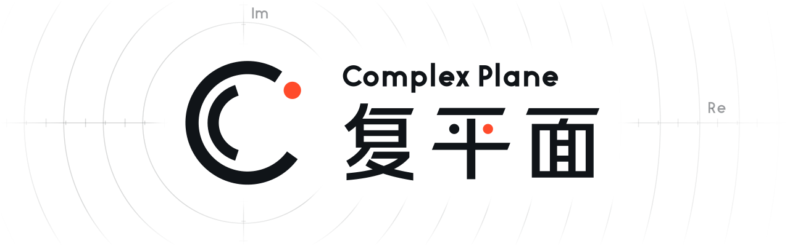

  <picture>
    <source media="(prefers-color-scheme: dark)" srcset="assets/banner-dark.svg">
    
  </picture>

  <b>In a complex world, seek real solutions.</b> 
  在复杂的世界里，求实在的解。

### About　关于

Every complex number has a **real part** and an **imaginary part**. We think good software does too: the part that works for you today, and the direction it can take you next. ComplexPlane Technology builds AI tools for real work — they take on messy, many-sided problems and hand back results you can use.

每个复数都有**实部**和**虚部**。好的软件也一样：今天就能为你所用的部分，和它接下来能带你去的方向。复平面做面向真实工作的 AI 工具，接过复杂、多面的问题，交还能直接用上的结果。

### How we work　我们的方式

<table>
  <tr>
    <td width="33%" valign="top">
      <code>Re</code> 
      <b>Real first.</b> 
      Start from the problem people actually have, and ship what works.  
      <b>先求实。</b>从真实的问题出发，交付跑得通的东西。
    </td>
    <td width="33%" valign="top">
      <code>Im</code> 
      <b>Imagine further.</b> 
      Keep a clear direction beyond the version you ship today.  
      <b>再求远。</b>今天的版本之外，保留清楚的方向。
    </td>
    <td width="33%" valign="top">
      <code>z</code> 
      <b>One point, placed precisely.</b> 
      Do one thing at a time, and put it exactly where it belongs.  
      <b>落点要准。</b>一次做好一件事，放在它该在的位置。
    </td>
  </tr>
</table>

### What we build　我们在做的

<table>
  <tr>
    <td width="64" align="center"></td>
    <td><a href="https://token-do.com"><b>TokenDo</b></a>　<code>coming soon</code> 
      Your desktop AI productivity tool. Say what you need, and documents, spreadsheets, slides and reports come back ready to use. 
      即将推出。桌面端 AI 生产力工具：说一句目标，文档、表格、PPT 和报告就交到你手上。 
      <a href="https://token-do.com">token-do.com</a> ↗
    </td>
  </tr>
</table>

<!--
### Get in touch　联系我们

联系邮箱确定后，取消这段注释并填入地址。
Website · <https://token-do.com>　Email · <hello@example.com>
-->

  <picture>
    <source media="(prefers-color-scheme: dark)" srcset="assets/mark-dark.svg">
    
  </picture>
   
  ComplexPlane Technology · 复平面

